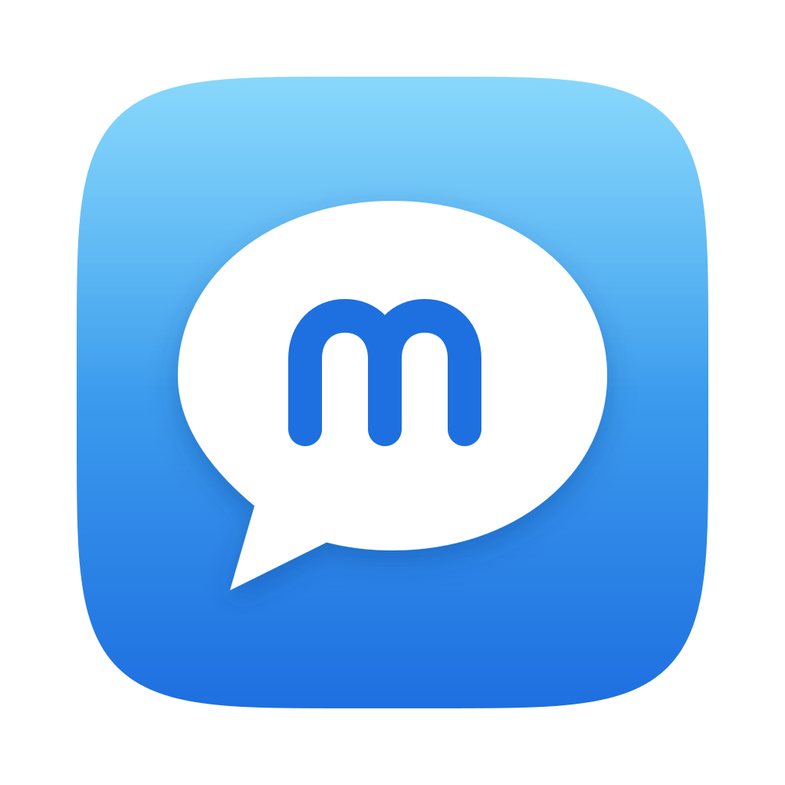
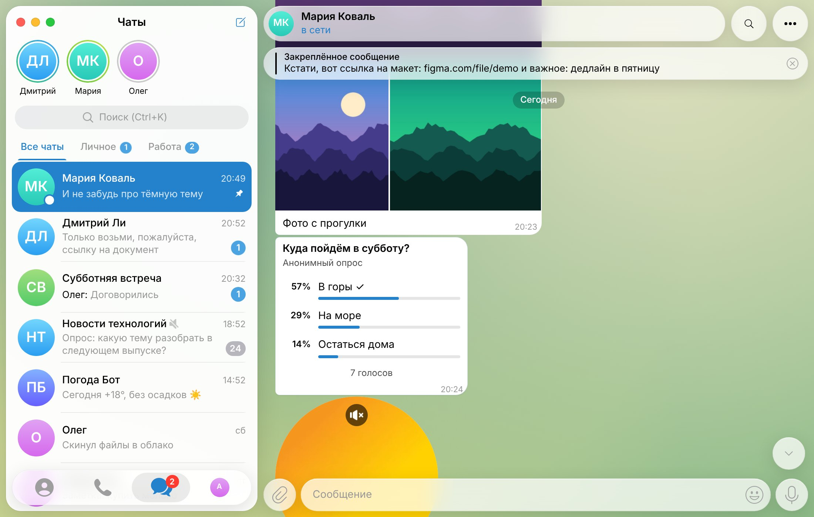

<h1 align="center">macgram</h1>

Telegram в стиле macOS — для Windows

  <a href="https://github.com/fvackingsonic/macgram/releases/tag/latest"><b>⬇ Скачать для Windows</b></a> ·
  <a href="https://fvackingsonic.github.io/macgram/">Сайт</a> ·
  <a href="CHANGELOG.md">Что нового</a> ·
  <a href="https://github.com/fvackingsonic/macgram/issues/new/choose">Сообщить об ошибке</a>

macgram — неофициальный клиент Telegram для Windows. Интерфейс, анимации и иконки повторяют
Telegram для macOS (новый дизайн «жидкое стекло»). Работает через официальную библиотеку Telegram — TDLib.

> **Ранняя версия (pre-alpha).** Возможны ошибки — пожалуйста, сообщайте о них.
> macgram не связан с Telegram FZ-LLC и Apple.

## Установка

1. Скачайте `macgram_…_x64-setup.exe` со страницы [последней версии](https://github.com/fvackingsonic/macgram/releases/tag/latest).
2. Запустите. Если Windows покажет «Windows защитила ваш компьютер» — нажмите
   **Подробнее → Выполнить в любом случае**. Это предупреждение появляется, потому что у программы
   пока нет платной цифровой подписи.
3. Войдите по QR-коду (Telegram на телефоне → Настройки → Устройства → Подключить устройство)
   или по номеру телефона.

Нужна Windows 10 или 11 (64 бита). Новые версии macgram находит сам: покажет, что изменилось,
и установит обновление в один клик.

## Возможности

- **Дизайн Telegram для Mac:** плавающий список чатов, стеклянные панели и кнопки, иконки из Mac-версии,
  темы Day Classic, День и Ночь, цвет акцента, свои шрифты
- **Анимации с Mac:** меню растёт из точки клика, анимированные иконки меню, прокручивающиеся счётчики,
  кнопки «тянутся» за курсором, плавный переход в профиль
- **Чаты:** папки (создание и настройка как на Mac), архив, поиск (Ctrl+K), истории, закреплённые сообщения, черновики в облаке, секретные чаты
- **Каналы и группы:** комментарии к постам, темы форумов, участники, администраторы, разрешения, пригласительные ссылки
- **Сообщения:** форматирование, ответы, правка, пересылка, реакции, опросы, поиск по чату (Ctrl+F),
  отложенные и тихие сообщения (правый клик по кнопке «Отправить»), кнопки ботов
- **Медиа:** фото и альбомы, видео, GIF, стикеры, голосовые и кружочки, музыка — плееры как на Mac
- **Отправка файлов:** скрепка, перетаскивание, вставка из буфера (Ctrl+V)
- **Настройки как на Mac:** общие, уведомления, конфиденциальность, сеансы, оформление,
  данные и память, энергосбережение

**Пока нет:** звонков и видеозвонков, создания тем в форумах, статистики каналов.

## Безопасность и данные

- Вход и переписка идут напрямую между вашим компьютером и серверами Telegram — через официальную
  библиотеку TDLib, без посредников.
- Локальная база зашифрована случайным 256-битным ключом. Ключ хранится в «Диспетчере учётных данных»
  Windows, а не в файлах.
- Можно включить код-пароль с автоблокировкой (Настройки → Конфиденциальность).
- Ссылки, у которых текст не совпадает с адресом, открываются только после подтверждения.
- macgram ничего не отправляет разработчикам. В интернет, кроме Telegram, программа обращается только
  к GitHub — чтобы проверить и скачать обновление (файл проверяется по контрольной сумме SHA-256).

## Нашли ошибку или есть идея?

В программе: **Настройки → Сообщить об ошибке**. Или сразу [на GitHub](https://github.com/fvackingsonic/macgram/issues/new/choose).
Пожалуйста, не прикладывайте скриншоты с личной перепиской, номером телефона или кодами входа.

## Частые вопросы

**Это официальный Telegram?** Нет, это сторонний клиент с открытым исходным кодом.

**Почему антивирус или SmartScreen ругаются?** У программы нет платной подписи, а каждая версия новая,
поэтому некоторые антивирусы с «машинным обучением» помечают её как подозрительную. Исходный код открыт.

**Мой аккаунт в безопасности?** macgram использует тот же протокол и ту же библиотеку, что и официальные
клиенты. Пароли и коды входа никуда, кроме Telegram, не передаются.

---

## Для разработчиков

| Часть | Что делает |
|---|---|
| **TDLib** (`tdjson.dll`) | Официальная библиотека Telegram: протокол MTProto, шифрование, секретные чаты, локальная база |
| **Rust / Tauri 2** (`src-tauri/`) | Окно, загрузка TDLib, ключи в «Диспетчере учётных данных», файлы, уведомления, обновления |
| **Интерфейс** (`ui/`) | HTML/CSS/JS без сборщиков; Preact и htm лежат в `ui/js/vendor` |

- **Сборка:** каждый коммит в `main` собирается GitHub Actions (`.github/workflows/build.yml`)
  и публикуется в релиз `latest`. Описание релиза берётся из верхнего раздела [CHANGELOG.md](CHANGELOG.md).
- **Версии:** файл `VERSION` — основа версии (например, `0.4`) и номер запуска сборки, с которого считается
  последняя цифра; итог — `0.4.0`, `0.4.1`, …
- **Ключи приложения:** чтобы вход был только по номеру, при сборке вшиваются секреты репозитория
  `MACGRAM_API_ID` и `MACGRAM_API_HASH` (выдаются на [my.telegram.org](https://my.telegram.org)).
  Без них программа при первом запуске попросит ключи сама.
- **Без TDLib:** интерфейс можно открыть в браузере — запустите любой локальный сервер в папке `ui`
  и откройте `index.html?mock=ready` (демо-данные) или `?mock=auth` (экран входа, код `12345`, пароль `demo`).

## Лицензия

[GPL-2.0](LICENSE). Иконки и анимации взяты из [Telegram для macOS](https://github.com/TelegramMessenger/telegram-macos) (GPL-2.0).
Telegram — товарный знак Telegram FZ-LLC; Mac и macOS — товарные знаки Apple Inc.
